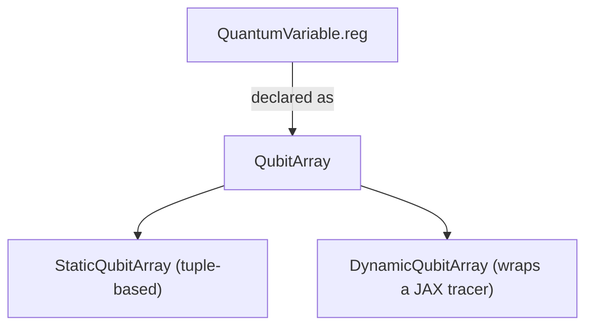

# RFC 003: Introduce a `QubitArray` base class

- Feature Name: `QubitArray` Class
- Start Date: 2026-11-11
- RFC PR: 
- Qrisp Issue: 

## Summary
[summary]: #summary

Qrisp's `QuantumVariable` has two modes: static (normal Python) and dynamic (Jasp tracing). Its `.reg` and `.qs` attributes hold different types depending on the active mode, and neither attribute has a type annotation today. As a result, mypy and pyright cannot catch bugs, and in-place list operations on `.reg` (such as `pop` and `insert`) break under Jasp without a clear error. This RFC proposes four incremental steps: a `ModeMixingError` for clear diagnostics, slicing-based register manipulation to replace `pop`/`insert`, a common `QubitArray` base class that unifies the register type, and typed stubs on the tracing session so static-only methods raise helpful errors instead of `AttributeError`.

## Motivation
[motivation]: #motivation

An algorithm that manipulates `.reg` in place (for example, a rotate-right in quantum backtracking) works in static mode but fails or raises a confusing error in Jasp. `.reg` is a `list[Qubit]` in static mode and a `DynamicQubitArray` in dynamic mode, and `DynamicQubitArray` does not provide `pop`, `insert`, or `append`. Neither `.reg` nor `.qs` has a type annotation, so a type checker cannot warn about this.

This affects two groups of people:

1. **Algorithm authors** who write code that needs to work in both modes. They discover the incompatibility at runtime, and the error message (`'DynamicQubitArray' object has no attribute 'pop'`) does not explain what went wrong or how to fix it.

2. **Anyone using a type checker.** Today, `.reg` and `.qs` are effectively `Any`: mypy will not catch `qv.reg.pop(0)` in traced code, typos on session methods, or mode mixing. Making Qrisp type-safe is a stated goal, and these two attributes are the biggest gap.

Jasp adoption is growing, more algorithms are being written to target both modes, and the fixes here are incremental: each step is useful on its own and does not require the others.

## Background and current architecture
[background-and-current-architecture]: #background-and-current-architecture

### QuantumVariable and its two modes

A `QuantumVariable` is a group of qubits that represents one value. Typed subclasses such as `QuantumFloat` add arithmetic. Every `QuantumVariable` exposes two key attributes:

- **`.reg`**: its qubit register
- **`.qs`**: its `QuantumSession`, the circuit it lives in

In **static mode** (normal Python execution), `.reg` is a `list[Qubit]` and `.qs` is a `QuantumSession`. Every Python call immediately appends a gate to the circuit.

In **dynamic mode** (Jasp tracing via `make_jaspr`), `.reg` is a `DynamicQubitArray` (a JAX tracer wrapper) and `.qs` is a `TracingQuantumSession`. The function runs once with placeholders, and the result is a Jaspr, a compiled representation that can be executed later with real-time feedback.

The key point is that it is the same class, but the attributes hold different types. Most library code is written to work in both modes, but the type system cannot verify this.

Today the class-level annotations look like this (from `quantum_variable.py`):

```python
reg: Any  # pyright: ignore[reportExplicitAny, reportUninitializedInstanceVariable]
qs: QuantumSession | TracingQuantumSession
```

The `Any` on `.reg` is an explicit opt-out: it acknowledges the problem without solving it. The union on `.qs` is more accurate, but it creates friction: static-only methods such as `statevector()` are not available on the union unless the type is narrowed first.

The union `list[Qubit] | DynamicQubitArray` describes the two possible runtime types of `.reg`; it is not the current annotation. The annotation is `Any`, which is exactly what hides the problem from type checkers.

### How mode detection works today

The codebase currently uses two patterns to determine the active mode:

```python
# Pattern 1: check the register type
if isinstance(self.reg, list):
    return len(self.reg)       # static
else:
    return self.reg.size       # dynamic

# Pattern 2: check the JAX tracing context directly
from qrisp.jasp import check_for_tracing_mode
if check_for_tracing_mode():
    ...  # dynamic path
```

`check_for_tracing_mode()` inspects `jax._src.core.trace_ctx` to check whether JAX is currently tracing. It does not look at the variable at all. It is used in 30+ call sites, including `QuantumVariable.__init__`, `extend`, `delete`, and many environment files. The `isinstance(self.reg, list)` check appears in the `size` property, `__iter__`, and throughout the quantum type subclasses. `.reg` is annotated as `Any` (a deliberate escape hatch) and `.qs` as `QuantumSession | TracingQuantumSession`. Because `.reg` is `Any`, mypy does not flag *anything*: `qv.reg.pop(0)` in traced code, typos, or mode mixing. And because `.qs` is a union, static-only methods such as `statevector()` appear as type errors unless the type is narrowed with `isinstance`.

### In-place register mutations

Several algorithms modify `.reg` in place using list operations:

```python
# quantum backtracking: rotate right (backtracking_tree.py:737)
self.h.reg.insert(0, self.h.reg.pop(-1))

# quantum backtracking: rotate left (backtracking_tree.py:761)
self.h.reg.append(self.h.reg.pop(0))

# modular multiplication: transfer LSB (modular_qft_multiplication.py:51-54)
lsb = from_qv.reg.pop(0)
...
to_qv.reg.insert(len(to_qv), lsb)

# ripple division (ripple_division.py:157-160)
lsb = qv.reg.pop(0)
qv.reg.insert(len(qv), lsb)

# QuantumVariable.reduce (quantum_variable.py:897)
self.reg.pop(j)
```

None of this works in Jasp because `DynamicQubitArray` does not expose `pop`, `insert`, or `append`. These algorithms cannot be traced today and remain limited to static mode.

The dynamic branch of `QuantumVariable.extend` already avoids in-place mutation by using concatenation (`self.reg + insertion_qubits`). The required pattern already exists in one place and only needs to be applied everywhere.

### The annotating-the-union approach does not work

Annotating `.reg` as `list[Qubit] | DynamicQubitArray` does not solve the problem. With a union type, the type checker only allows operations that are valid on *both* branches. `qv.reg[0]` is fine, but `qv.reg.append(x)` becomes a type error everywhere, including in code that only runs in static mode. Every list operation would need an `isinstance` guard, even in code paths that are already guaranteed to be static.

## Proposed design
[proposed-design]: #proposed-design

The proposal has four steps. Each one is useful on its own, though step 3 is the core typing change. They can be implemented and merged in any order.

### Step 1: `ModeMixingError`, a clear error when modes are crossed

`ModeMixingError` is raised when a static `QuantumVariable` is used inside a traced function, or a dynamic one is used outside.

```python
class ModeMixingError(Exception):
    """A QuantumVariable was used in a mode it does not belong to."""
```

Mixing modes currently either silently does the wrong thing or raises a cryptic error. With this check, the mode becomes a property of the *code region*, not the object: inside `make_jaspr`, every `QuantumVariable` created there is guaranteed to be dynamic.

**Example:**

```python
from qrisp import QuantumVariable, make_jaspr

qv = QuantumVariable(3)  # static, created outside make_jaspr

def main():
    h(qv)  # qv is static, but the code is in tracing mode

make_jaspr(main)()

# Today: confusing behavior or an opaque JAX error
# After Step 1: ModeMixingError with a message like
#   "A static QuantumVariable was used inside a traced function.
#    Create the variable inside the function passed to make_jaspr."
```

Where to place the check is an open question: at gate application time, at qubit indexing time, or both. Gate application catches more cases; qubit indexing catches them earlier. The two options can coexist.

### Step 2: Slicing instead of `pop`/`insert`

This step replaces in-place register mutations (`pop`, `insert`, `append`) with slicing and concatenation (`+`), which work in both modes.

`DynamicQubitArray` already supports `+` with lists on both sides and slicing, so the same expression works whether `.reg` is a `list` or a `DynamicQubitArray`. This unblocks several algorithms for Jasp tracing.

**Example: before and after:**

```python
# ROTATE RIGHT
# Before (static only):
self.h.reg.insert(0, self.h.reg.pop(-1))
# After (both modes):
reg, n = qv.reg, qv.size
qv.reg = reg[n - 1:] + reg[:n - 1]

# ROTATE LEFT
# Before (static only):
self.h.reg.append(self.h.reg.pop(0))
# After (both modes):
reg = qv.reg
qv.reg = reg[1:] + reg[:1]

# TRANSFER LSB (modular multiplication)
# Before (static only):
lsb = from_qv.reg.pop(0)
...
to_qv.reg.insert(len(to_qv), lsb)
# After (both modes):
lsb = a.reg[0]
a.reg = a.reg[1:]
b.reg = b.reg + [lsb]

# EXTRACT CARRY (adders)
# Before (static only):
cout = c.reg.pop(-1)
# After (both modes):
cout = c.reg[-1]
c.reg = c.reg[:-1]
```

The dynamic branch of `QuantumVariable.extend()` already uses this style, so the static branch can use the same approach.

**Note:** this step changes `.reg` from a mutation to a reassignment. Code that holds a reference to the old list will not see the update. In practice, the affected algorithms all access `.reg` through `self`, so this is not an issue for internal code. External code that does `my_list = qv.reg; qv.reg = ...` will need to re-read `.reg`, but the old pattern (`my_list = qv.reg; qv.reg.pop(...)`) was already fragile in the same way.

### Step 3: `QubitArray`, a common base class for registers

This step introduces a `QubitArray` abstract base class that captures what both register types support: `.size`, indexing (`__getitem__`), slicing, and `+`. Static registers become `StaticQubitArray` (based on `tuple`, immutable), and dynamic registers stay as `DynamicQubitArray`. `.reg` is then annotated as `QubitArray`.



This is the key step. With `.reg: QubitArray`, a type checker knows exactly which operations are valid in mode-agnostic code. No `isinstance` guards are needed: if an operation exists on `QubitArray`, it works in both modes. And `qv.reg.pop(0)` becomes a type error, which is correct because it does not work in dynamic mode.

**The interface looks like this:**

```python
qv.reg.size        # ok in both modes: returns int (or tracer)
qv.reg[1:]         # ok in both modes: slicing
qv.reg.pop(0)      # type error: not on QubitArray
len(qv.reg)        # type error: DynamicQubitArray has a tracer size, not an int
```

**Using `tuple` for static registers:** The purpose of Step 2 is to stop mutating `.reg` in place. A tuple enforces that at the type level: `StaticQubitArray` is immutable, like `DynamicQubitArray`. The register is reassigned as a whole, never mutated.

**`len()` and iteration are excluded:** `DynamicQubitArray.size` is a JAX tracer, not an `int`. Python's `__len__` must return an `int`, so `len()` cannot be part of the common interface. Iterating over a dynamic register also does not make sense when the size is not known statically. Code that needs `len(qv.reg)` is inherently static-only. Truthiness works the same way: `bool(qv.reg)` falls back to `__len__`, so `if qv.reg:` is also static-only and raises on a dynamic register.

### Step 4: Typed stubs on `TracingQuantumSession`

For methods that only make sense in static mode, such as `statevector()`, `compile()`, and `depth()`, `TracingQuantumSession` gets explicit stubs that raise a clear error.

**Example: before and after:**

```python
def main():
    qv = QuantumFloat(3)
    return qv.qs.statevector()

make_jaspr(main)()

# Today:
#   AttributeError: 'TracingQuantumSession' object has no attribute 'statevector'
# After Step 4:
#   StaticModeOnlyError: "statevector() is only available in static mode.
#   This code is running inside make_jaspr()."
```

`AttributeError` does not explain why the method is missing. A typed stub means (a) mypy knows the method exists and can check the call signature, and (b) the runtime error explains what is happening.

After this step, `.qs` can be typed as `QuantumSession` unconditionally (since `TracingQuantumSession` inherits from `QuantumSession` and now has all the same methods), and `qv.qs.statevector()` type-checks in both modes; it only raises at runtime in the wrong one.

## Unresolved questions
[unresolved-questions]: #unresolved-questions

- **Where should the mode check (Step 1) run?** At gate application, at qubit indexing, or at `QuantumVariable` construction? Gate application is the most general checkpoint, but qubit indexing catches the problem earlier. Both options can coexist.

- **What happens to `QuantumVariable.reduce` and `QuantumVariable.extend`?** These methods change the register size and may need special handling under the new typing. `extend` already has a dynamic branch; `reduce` may need one.

- **Should `.reg` stay public?** Individual qubits are also accessible via `qv[i]` and `qv[a:b]`. If `.reg` were made internal (`._reg`), the public interface would be purely through `__getitem__` / `__setitem__`, and the typing story would simplify. But `.reg` is used in a lot of existing code, both internal and user-facing.

- **Are there other structural blockers for type safety?** The `.reg` / `.qs` split is the largest one, but other attributes or functions may have similar dual-type patterns that should be addressed in the same sweep.

- **What about `isinstance(qv.reg, list)` in user code?** After Step 3, `qv.reg` is never a `list`: it is either a `StaticQubitArray` or a `DynamicQubitArray`. Code that does `isinstance(qv.reg, list)` will get `False` in both modes. A migration path is needed, either `isinstance(qv.reg, StaticQubitArray)` or a helper such as `qv.is_static`.

## Future possibilities
[future-possibilities]: #future-possibilities

- **Full `py.typed` compliance.** Once `.reg` and `.qs` are typed, the next step is annotating the rest of the public API: gate functions, the `QuantumCircuit` subclasses, and the compilation pipeline. This RFC is a prerequisite for that work.

- **Generic `QuantumVariable[Mode]`.** A more ambitious approach parameterizes `QuantumVariable` by its mode: `QuantumVariable[Static]` vs `QuantumVariable[Dynamic]`. This would let functions declare which mode they support at the type level. It is significantly more complex and probably not worth it unless the mode-agnostic pattern proves too limiting.

- **Protocol-based typing.** Instead of a `QubitArray` ABC, the register interface could be defined as a `typing.Protocol`. This avoids inheritance and works with structural subtyping, which is more Pythonic. The downside is that protocols are harder to discover: a base class shows up in `help()` and IDE class hierarchies.

- **Linting for mode-specific code.** A custom mypy/pyright plugin could detect `isinstance(qv.reg, list)` patterns and suggest the new idiom, or flag code that uses `list`-only operations without a mode guard.

- **Qubit-level type safety.** `Qubit` itself has a similar static/dynamic split. A `TypedQubit` or parameterized `Qubit[Mode]` could extend the same pattern to individual qubits.

## Public API impact
[public-api-impact]: #public-api-impact

### Additions

- `ModeMixingError` is the new exception raised when a `QuantumVariable` is used in the wrong mode.
- `QubitArray` is the new abstract base class for qubit registers, with `.size`, `__getitem__`, and `__add__`.
- `StaticQubitArray` is the new class for static-mode registers, based on `tuple`. It replaces `list[Qubit]`.
- Error stubs are added on `TracingQuantumSession` for static-only methods (`statevector`, `compile`, `depth`, etc.).

### Breaking changes

- **`qv.reg` is no longer a `list`.** In static mode it becomes a `StaticQubitArray` (tuple-like). Code that calls `.pop()`, `.insert()`, or `.append()` on `qv.reg` will break. **Migration:** use slicing and `+` as shown in Step 2.
- **`isinstance(qv.reg, list)` returns `False`.** Code that checks the mode this way must switch to `isinstance(qv.reg, StaticQubitArray)` or use `check_for_tracing_mode()`.
- **`if qv.reg:` is static-only.** Truthiness falls back to `__len__`, so it raises on a dynamic register instead of returning `True`. Use an explicit check such as `qv.reg.size > 0`, or branch on `check_for_tracing_mode()` where the mode matters.
- **`some_list += qv.reg` is no longer type-safe.** A tuple-based `StaticQubitArray` is still iterable at runtime, so this may appear to work in static mode, but iteration is not part of the `QubitArray` interface and type checkers will flag it. Use `some_list.extend(qv.reg)` or `list(qv.reg)` explicitly if that is the intended behavior.

### Backwards compatibility

Steps 1, 2, and 4 are non-breaking. Step 3 (the `QubitArray` change) is the only one that changes the type of `.reg`. It can be rolled out with a deprecation period:

1. First, add `QubitArray` and `StaticQubitArray` but keep `.reg` as a `list`.
2. Add deprecation warnings on `.reg.pop()`, `.reg.insert()`, `.reg.append()`.
3. In the next minor release, switch `.reg` to `StaticQubitArray`.

Alternatively, since in-place mutation of `.reg` was never part of the documented API, the change could be made directly with a changelog entry.
